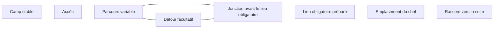

# Cahier de génération de la campagne

17 octobre 2026 · **MONDE-PM02-01** · préparation du premier secteur.

## Base acceptée

L’[accord MONDE-01 à MONDE-04](reviews/refonte-histoire-2026-10-16/world-generation-study-01/design-acceptance-01.json)
retient la génération hybride : camps stables, parcours assemblés, lieux
importants préparés à la main, trajet principal avec détours et quelques boucles.
Le plan reste conservé pendant une partie ; une nouvelle campagne peut varier
les parcours. Le renouvellement des ennemis et récompenses reste à définir.

Le joueur précise que de nouveaux décors seront produits **tout au long du
développement des cartes**. Plan, ambiance et lisibilité seront donc travaillés
ensemble, par lots. Les finitions globales de PM11 complètent ce travail progressif.

Il confirme ensuite la proposition et demande à **voir chaque lieu préparé à
la main avant de le valider**. Cet accord sur l’organisation ne valide aucun
plan concret. Camps, lieux obligatoires, futures arènes et autres morceaux
préparés seront présentés avec identifiant stable, vue d’ensemble et vue à
l’échelle du jeu. Plan et décors auront des validations distinctes ; une
révision rouvrira la validation de la partie modifiée. L’accord figure dans
[MONDE-PM02-ACCEPT02](reviews/refonte-histoire-2026-10-16/world-layout-review-02/design-acceptance-02.json).

Ce cahier décrit les rôles et raccords à préparer. Les exemples suivants sont
des propositions de structure, sans nouvelle quête, appellation de lieu,
compétence, règle de voyage ou valeur de combat intégrée. Les identifiants
techniques ne sont pas des noms affichés au joueur.

## Familles de cartes et de modules

Ces familles décrivent des fonctions réutilisables. Une carte peut combiner
plusieurs familles ; leur nombre n’impose pas le nombre de cartes du secteur.

| Identifiant | Fonction | Construction prévue | Accès et réservations |
| --- | --- | --- | --- |
| MAP-CAMP | Refuge et services | Plan compact préparé, stable dans la partie | Accès au secteur, sorties de services, emplacements de PNJ et futur voyage entre camps |
| MAP-ACCESS | Approche et orientation | Morceaux assemblés, premières bifurcations lisibles | Arrivée dégagée, raccords au parcours, repères de direction |
| MAP-INTERIOR | Salles et circulation intérieure | Modules de salles, couloirs et jonctions compatibles | Portes, raccords, lignes de vue et emplacements de rencontres |
| MAP-OPEN | Halls, cours ou grandes cavités | Surface organisée autour de morceaux préparés | Circulation autour d’obstacles, accès multiples et silhouettes visibles |
| MAP-DETOUR | Exploration facultative | Branche ou boucle composée avec les familles précédentes | Intérêt facultatif réservé, retour vers la route principale avant un passage obligatoire |
| MAP-LANDMARK | Lieu indispensable au parcours | Morceau préparé, emplacement ou variante compatible avec le parcours | Accès obligatoire, éventuel contrôle réservé, sortie après le lieu |
| MAP-ARENA | Emplacement du futur chef | Volume réservé, arène définitive conçue avec le boss à PM09 | Arrivée, aire de combat et transition ; aucun pattern de boss défini ici |

Une salle de maintenance est, par exemple, un module possible de MAP-INTERIOR ;
un hall de manutention relève de MAP-OPEN. Leur rôle graphique ne leur attribue
pas automatiquement des ennemis, du butin ou un effet de terrain.

## Organisation proposée du premier secteur

Le point de départ de travail est le secteur des accès fortifiés du manuscrit.
Les noms et quêtes proposés dans ce manuscrit gardent leur statut propre.
Le schéma précise la boucle déjà acceptée : le détour rejoint le parcours
**avant** le lieu obligatoire, pour éviter d’en offrir un contournement.

Les boîtes sont des rôles de parcours. Le parcours variable peut occuper
plusieurs modules dans une même carte ou plusieurs cartes ; ce découpage
sera mesuré avec le premier prototype. Le raccord vers la suite ne constitue
pas une proposition de carte supplémentaire ou de déplacement automatique.

Le lieu obligatoire dispose d’un emplacement réservé, mais son action précise
reste ouverte. Aucune nouvelle clé, console, livraison ou condition de quête
n’est créée par le schéma. Le chef bénéficie d’une place distincte ; son dessin,
ses mécaniques et la conclusion de l’acte seront traités dans leurs revues.

## Contrat de raccordement des modules

Chaque module devra décrire :

- Son identifiant et sa version, sa famille et ses variantes de plan.
- Les cases de sol, les éléments bloquants et la couche de décor correspondante.
- Ses accès, leur côté, leur profil d’ouverture et les cases d’arrivée dégagées.
- Les raccords compatibles et les transformations effectivement disponibles.
- Les emplacements réservés : objectif, interaction, rencontre, récompense,
  repère et éventuel accès à une excursion.
- Les accès indispensables entre ces emplacements, y compris après décoration.

Deux ouvertures raccordées doivent correspondre dans leurs dimensions, leur
position et leur circulation. Les largeurs seront définies au prototype ;
une étiquette « couloir » ne remplace pas ce contrôle. Une porte ouverte doit
déboucher sur une zone praticable du module voisin.

Le générateur ne tournera ni ne réfléchira automatiquement une illustration
pour obtenir toutes les orientations. On utilisera les orientations ou
compositions réellement disponibles, avec la même lumière que les personnages.
Une variante géométrique et une variante de matériaux sont deux choses distinctes.

## Séparer le plan, son état et son apparence

L’identité d’une carte repose sur la campagne, un identifiant stable de carte
et la version de génération. La graine locale ne devra pas dépendre de l’ordre
dans lequel les cartes voisines sont visitées.

La géométrie de base générée est conservée. Les changements produits par les
actions déjà prises en charge — portes, dispositifs, objets ou faits de quête —
restent des états de la carte à sauvegarder ; conserver un plan ne signifie
pas remettre ces éléments dans leur état initial à chaque visite.

Les variations purement visuelles devront utiliser un tirage séparé de celui
du plan et des rencontres. Ajouter une variante de sol ne doit pas déplacer
un objectif ou changer le prochain tirage de butin. Un décor qui bloque une
case ou change la vue appartient, lui, aux données de circulation à contrôler
et à versionner. Une image ne crée pas cette règle implicitement.

Les sauvegardes existantes gardent leur contrat de génération. Aucun passage
à une nouvelle version du monde ne sera activé par une simple modification
de ce document ou d’une source graphique.

## Décors construits avec les cartes

Le [plan de production des décors](DECORS_CAMPAGNE.md) suit les besoins du
premier parcours : sol, murs, coins et portes, puis mobilier et repères propres
aux modules réellement utilisés. Les sources existantes des personnages,
armes et monstres servent de référence pour l’échelle et la simplification.

Les premières compositions seront montrées sur la grille de 64 px avec le
joueur et quelques silhouettes déjà acceptées. Les objets graphiquement hauts
devront laisser lire acteurs, passages, objets au sol et zones tactiques.
Les ombres et effets restent des couches distinctes. Les illustrations et
éventuels effets nouveaux suivent leur revue avant intégration.

Les sols ne doivent pas attirer autant l’attention que les créatures et les
objets utiles. Les murs et portes doivent faire comprendre où le joueur peut
circuler ; une rayure de sol ne doit pas sembler être une barrière. Les éléments
de décor réutilisables auront des jonctions propres pour éviter les coutures
visibles entre modules.

## Contrôles avant le raccordement au jeu

La vérification du premier prototype devra couvrir :

1. L’accès au parcours et à la sortie, avec retour possible selon les règles retenues.
2. Le passage par les lieux obligatoires dans l’ordre prévu ; aucun détour ne les évite.
3. L’accès au contrôle ou objet requis avant le passage qu’il ouvre, lorsqu’un tel effet aura été validé.
4. La correspondance des ouvertures entre modules, sans entrée dans un mur ou sur un objet.
5. La conservation des accès après pose du mobilier, des décors et des points d’apparition.
6. Des approches et replis lisibles avec mêlée, distance, magie et familiers.
7. La reproduction du même plan après chargement et visite dans un autre ordre.
8. L’indépendance des variantes graphiques et des tirages de jeu.

Les dimensions, nombres de modules, densités et rythmes de renouvellement ne
sont pas fixés ici. Les grandes silhouettes ne changent pas automatiquement
l’occupation physique des cases. Le prototype testera plusieurs graines avant
de servir de base aux cartes supplémentaires.

## État et passage à PM03

La direction MONDE-01 à MONDE-04 et la production progressive des décors sont
acceptées. Ce cahier détaille leur préparation technique ; le découpage exact
des cartes, leurs dessins et les nouveaux effets restent à examiner lorsqu’ils
seront concrets. Les données de revue sont dans
[`world-layout-review-02`](reviews/refonte-histoire-2026-10-16/world-layout-review-02/).

Le premier travail de PM03 sera un assemblage de modules et une carte de revue,
avec les premiers décors nécessaires. Son objectif est de vérifier circulation
et lecture. Le premier camp dispose d’un
[plan candidat PLACE-CAMP-01](reviews/refonte-histoire-2026-10-16/handcrafted-places-review-01/README.md),
à examiner avant toute validation de ce lieu ; ses décors restent à créer.
Les problèmes critiques de sauvegarde de PM00 doivent être traités
avant son activation en campagne ; le bilan des 28 échecs d’application recensés
n’est pas transformé ici en certification de stabilité.
