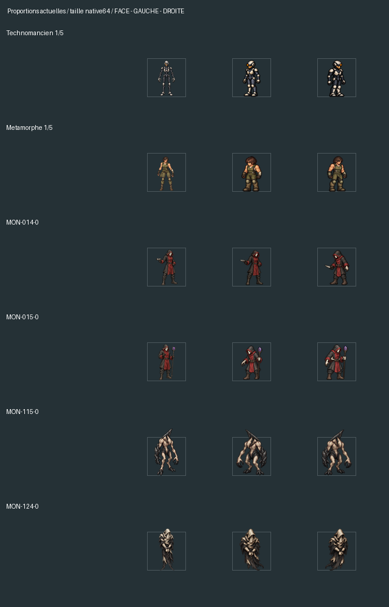

# Vérification générale des proportions —25 octobre2026

La cohérence face/marche n'est pas encore acquise pour l'ensemble. L'audit
confirme le défaut des personnages et relève plusieurs silhouettes de monstres
à reprendre. Il distingue ces changements de gabarit des variations normales
de posture, ainsi que des créatures qui n'ont pas de cycle actif.

Les dessins installés et l'exécutable Release n'ont pas été modifiés. Les
comparaisons portent sur le lecteur normal WALK09 ; le premier essai corrigé
du Bastion reste séparé, dans la revue WALK10.

## Périmètre effectivement vérifié

| Ensemble | Contrôle |
| --- | --- |
| Cinq classes,25 tenues | Face et14 poses latérales, sans casque et avec chacun des six casques :175 configurations. |
| Hachette67 équipée | Les25 tenues, face et14 poses ; l'arme est exclue des mesures du corps. |
| Les113 modèles d'armes | Première tenue de chacune des cinq classes, repos et passage du pied dans les deux sens :565 configurations,2260 poses. |
| Monstres de campagne | Les471 couples modèle/couleur, comparés aux14 poses de leur base :6594 comparaisons. |
| Géométries de campagne distinctes | Les129 bases et leurs1806 poses ont été examinées sur17 planches natives. Les variantes ont exactement le même alpha, la même échelle et les mêmes ancrages que leur base. |
| Transformations et drones | Six formes et quatre drones, face et14 poses chacun. Seul le cycle du canonnier est actuellement actif parmi ces dix cas. |
| Autres voies de dessin | Inventaire des27 indices d'acteurs,65 entrées du bestiaire historique et quatre PNJ du camp ; ils n'ont pas de cycle de marche distinct actif. Ces entrées comprennent des doublons et des cibles fixes. |
| PNJ de service20 à25 | Contrôle supplémentaire du rendu réel au repos et pendant un déplacement, sans arme et avec la hache, à64 et96px :24 comparaisons de pixels identiques dans leur case. |
| Hologrammes | Réutilisent le corps de joueur ou la forme existante avec un effet de couleur/transparence ; aucun corps autonome ni cycle latéral propre. |

Les175 configurations de corps et les25 avec hache représentent2800 poses
mesurées. Toutes les combinaisons armure × casque × arme × couleur × pose ne
sont pas énumérées : le détail de l'échantillonnage des armes est explicite
dans `audit.json`. Les identifiants `MON-xxx` sont ceux des ressources du jeu ;
ils peuvent différer des anciens numéros « M… » du catalogue.

## Résultats pour les personnages

Les cinq familles montrent des différences de proportions à corriger. Les
signaux numériques concernent23 des25 tenues sans casque ; les deux autres
ne constituent pas une validation artistique. Le Bastion en tenue1 illustre
qu'un écart visuellement gênant peut passer sous un seuil de deux pixels.

Les différences les plus nettes de volume concernent le Technomancien et
la Métamorphe : les figures latérales ont une tête, des bras ou un buste plus
massifs que leur face. Le défaut persiste avec l'arme équipée et les casques.
Les mesures ne comptent pas la lame ou la hampe comme une partie du corps.

La cause déjà identifiée reste commune : le conditionnement WALK09 se base
sur l'ancienne animation latérale pour sa hauteur cible ; il ne vérifie pas
les proportions de chaque tenue par rapport à son propre dessin de face.
Stabiliser la hauteur dans un cycle ne suffit donc pas.

## Monstres : priorités identifiées

Les cas suivants montrent une différence visible de silhouette globale,
avec une augmentation de volume déjà présente dans les repos de trois quarts :

| Ressource | Constat principal |
| --- | --- |
| MON-014-0 | La projection droite devient beaucoup plus massive que la face et que la gauche, notamment le buste et les jambes. |
| MON-015-0 | Le personnage mince de face devient plus trapu dans ses deux cycles ; les volumes diffèrent aussi entre directions. |
| MON-115-0 | La silhouette allongée de face prend des bras, épaules et un torse plus épais pendant la marche. |
| MON-124-0 | La hauteur reste presque identique, mais la silhouette latérale est nettement plus large et pleine. C'est un exemple que le contrôle de hauteur seul ne détecte pas. |

Les couleurs des variantes ne changent pas la géométrie de ces quatre bases ;
la même reprise de dessin devra donc servir à leurs variantes, sans modifier
leur identité ni leur palette.

MON-101 et MON-141 nécessitent un examen différent : la carapace du premier
et l'enroulement du second changent beaucoup la hauteur visible. Le ver141
varie de64 à76px dans son cycle pour77px sur la référence de face. Cette
différence de hauteur ne prouve pas, à elle seule, un changement d'échelle :
il faut comparer l'épaisseur du corps et la taille de la tête en tenant compte
de l'enroulement. Ces cas ne doivent pas être forcés à une hauteur constante.

Le seuil strict de deux pixels déclenche des signaux sur97 des129 cycles de
base ;52 ont aussi un écart de plus de deux pixels entre la face et au moins
un repos latéral. Ce sont des listes d'examen, pas97 défauts de taille prouvés.
La flexion des pattes, le chevauchement des membres, les cornes et les ailes
peuvent modifier la boîte ou la surface visible sans changer le physique.

## Animation absente et petite taille : problèmes séparés

Les129 bases de campagne disposent de leurs cycles dans le jeu normal. Les
342 variantes de couleur restent sur le rendu fixe ; leurs cycles proposés
utilisent pourtant la même géométrie que la base. Elles sont recensées dans
`audit.json`, sans compter leur glissement comme une marche validée.

Les cultistes022/024 restent petits dans les deux états :49 et48px, face et
cycle compris. Ils n'ont donc pas le même défaut que le Bastion qui grossit
au changement d'orientation. Leur gabarit absolu reste à reprendre.

Parmi les formes/drones, huit cycles déclenchent le contrôle strict de hauteur,
dont le Prédateur et le Gardien. Neuf de ces cycles sont encore des propositions.
Le canonnier conserve des mesures stables. Les cibles fixes et les PNJ immobiles
peuvent conserver un dessin fixe ; l'absence de cycle actif est inventoriée
séparément de la qualité des proportions.

## Méthode et limites

L'audit utilise le compositeur réel des personnages et les images canoniques
réellement sélectionnées pour les monstres. Il mesure l'alpha à partir de96,
la hauteur, la largeur, la surface opaque, la différence entre directions et
la stabilité des14 poses. La mesure de largeur haute et de surface reste une
mesure de silhouette2D ; elle ne calcule pas un volume anatomique3D. Les armes
et ailes dessinées dans les figures de monstres ne peuvent pas être séparées
comme les armes modulaires du joueur.

La revue visuelle des30 planches comprend les25 tenues sans arme et avec la
hache, toutes les129 bases de monstres, les dix formes/drones et24 cas de
casques signalés. Les autres casques et l'échantillon complet des113 armes
sont couverts par les mesures, sans prétendre à une inspection manuelle de
toutes les combinaisons possibles.

Les exportations CPU sont comparées à taille native64. Le contrôle des PNJ
utilise en plus des captures du moteur. L'audit n'est pas une traversée de
toutes les rencontres d'une sauvegarde ; il contrôle les ressources et leurs
voies de rendu, sans créer ni modifier une campagne.

## Suite à appliquer aux corrections

Chaque tenue et chaque espèce doit prendre son propre dessin de face comme
référence de physique : taille de tête, longueur des membres, largeur du
buste, épaisseur de l'armure et dimensions des mains/pieds. La projection
de trois quarts et la flexion des appuis doivent conserver ce même physique.
Les armes restent rigides et les monstres gardent leur anatomie propre.

Le premier essai du Bastion fournit une base de comparaison pour cette reprise,
sans valider les autres dessins. Les futures corrections devront être montrées
avec leur face, les deux directions et l'équipement réel, puis contrôlées avec
le même audit avant intégration. Aucun redimensionnement global des monstres
n'a été appliqué pendant cette vérification.

## Fichiers et reproduction

- `audit.json` : toutes les mesures, le statut des cycles et les limites.
- `cases.csv` : tableau filtrable par identité, hauteur et signaux.
- `summary.json` : couverture et index des30 planches.
- `players/`, `players-axe/`, `players-helmet-alerts/` : comparaisons de joueur.
- `campaign/` : les17 planches des129 géométries distinctes.
- `forms-drones/` : les dix comparaisons supplémentaires.
- `npc-check/` : captures réelles et24 comparaisons identiques.
- `checks.json` : contrôles techniques et empreintes protégées.

Pour reproduire l'export, lancer les diagnostics ignorés `audit_all_` avec
`RL_PROPORTIONS_OUTPUT` vers un dossier d'exports, puis
`tools/art/audit_walk10_all_proportions.py`. Le contrôle natif des PNJ utilise
`--ui-cold-proportions-npcs OUTPUT` dans l'exécutable Debug. Ces outils ne
deviennent pas des dépendances du jeu.
