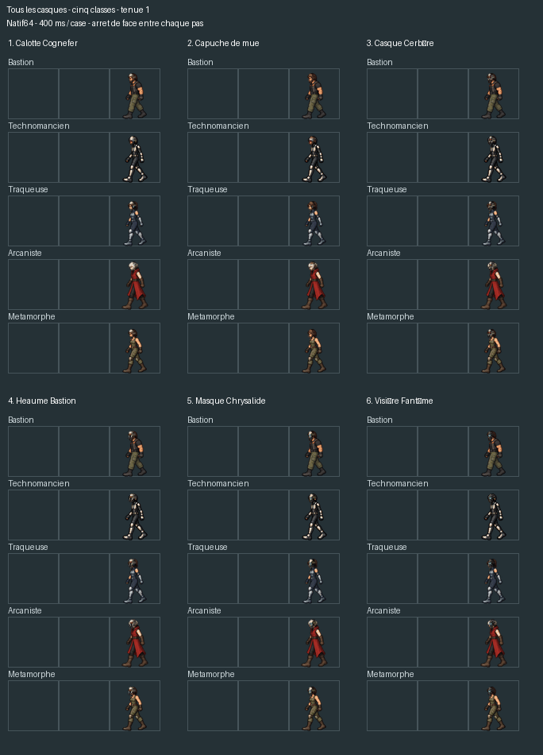

# Les six casques — marche des cinq classes

Le catalogue actuel contient six équipements de tête, tous couverts par la
correction WALK12-HELMET-ORIENTATION-r02 déjà intégrée : Calotte Cognefer,
Capuche de mue, Casque Cerbère, Heaume Bastion, Masque Chrysalide et Visière Fantôme.

Les identifiants de contenu et leurs modèles visuels115 à120 ont été contrôlés
ensemble. Les cinq classes et leurs cinq tenues donnent150 combinaisons
casque/tenue. La coque suit l'orientation et l'inclinaison de la tête ; les
ouvertures conservent le visage de marche et chaque arrivée reprend la vue de face.

L'aperçu d'ensemble montre les six modèles sur les cinq classes en tenue1 :



Les cinq aperçus supplémentaires de tenue et les grandes planches individuelles
ont été retirés lors du nettoyage demandé le25 octobre2026. L'aperçu d'ensemble
ci-dessus reste conservé. Chaque déplacement parcourt une case en400ms ; la
pause de300ms sert uniquement à lire l'arrêt dans l'aperçu.

Ces aperçus réutilisent les exports du compositeur normal, dont les empreintes
du code et de la version Release ont été vérifiées. Aucun changement de code
du jeu supplémentaire n'était nécessaire. Les contrôles et le catalogue exact
sont dans `all-helmets.json` ; les tests de rendu restent dans `validation.json`.

Pour revoir les configurations dans le moteur, utiliser `Voir_animations.cmd`
à la racine du projet. Pour régénérer les planches hors fenêtre :

```powershell
$env:RL_WALK_HELMET_OUTPUT = 'artifacts/walk-helmet-02/after'
cargo test --locked --bin project-rl walk_helmet_alignment_diagnostic -- --ignored --test-threads=1
C:\Python314\python.exe tools/diagnostics/review_all_walk_helmets.py
```

Les anciens noms de GIF dans `all-helmets.json` décrivent le contrôle effectué
avant nettoyage. Le registre des sorties retirées est dans
`docs/maintenance/nettoyage-2026-10-25/`.
