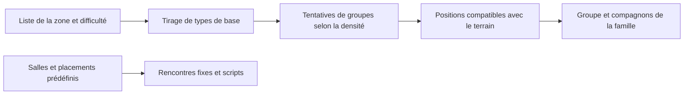

# Diablo II et PD2 — progression des menaces et placement

17 octobre 2026. Étude demandée pour préparer le bestiaire de Project RL.
Le joueur accepte ensuite le principe des familles pour Project RL, avec
le budget présenté comme point de départ. Cette décision de conception est
consignée dans [design-acceptance-01.json](design-acceptance-01.json).
Les rencontres, comportements ou chiffres du jeu ne sont pas modifiés.

## Ce qui a été effectivement étudié

Installation locale : `D:\JEUX\Diablo 2 old\Diablo II` et son sous-dossier
`ProjectD2`. Les tables sont extraites par les fonctions de lecture de la
bibliothèque SFMPQ déjà présente dans l'installation. Les originaux restent
en place ; aucune fonction d'écriture d'archive n'est appelée. Aucune partie
n'a été lancée et aucune sauvegarde n'est consultée. Ce relevé décrit les
données et une architecture de référence, pas l'observation d'une carte jouée.

Deux couches sont comparées : `patch_d2.mpq` du répertoire LoD et
`ProjectD2/pd2data.mpq`. Les tables de zones, monstres, placements prédéfinis,
superuniques et morceaux de cartes sont disponibles. Les fichiers compilés
Levels.bin et MonStats.bin sont aussi relevés. Les empreintes des archives,
les chiffres et les exemples sont dans [counts.json](counts.json).

Sur les 131 lignes de campagne retenues, pour chacune des deux archives,
les listes normales, Cauchemar/Enfer et uniques, les densités et NumMon ont
été comparés aux champs du Levels.bin compilé : ils correspondent. Les BaseId
des monstres référencés sont également comparés à MonStats.bin.
Le périmètre est Id 1 à 132, hors niveau bonus des vaches Id 39. Les identifiants
textuels doublonnés sont conservés lors de la lecture des indices compilés.

PD2 contient ici 202 enregistrements compilés de zones, contre 137 dans
l'archive LoD. Cela ne signifie pas 202 cartes de campagne ou 65 cartes
supplémentaires à parcourir : cette table contient aussi des villes,
zones de boss, espaces bonus et entrées techniques. Aucune saison précise
n'est déduite du nom de l'installation.

## Combien de types d'ennemis par acte ?

Pour compter utilement, il faut séparer le dessin, la famille technique,
la variante, le rôle tactique et le nombre de types sélectionnés par zone.
Une nouvelle couleur et un nouveau rang ne sont pas forcément une nouvelle
silhouette. Deux ennemis partageant des éléments graphiques peuvent avoir des
rôles différents. Le bestiaire officiel classe les monstres dans l'acte de
leur introduction, mais précise qu'ils reviennent ailleurs. [Arreat Summit](https://classic.battle.net/diablo2exp/monsters/).

Le relevé suivant regroupe les listes normales `mon1…` par `BaseId`. Il compte
des **familles techniques potentiellement tirables** dans les zones de l'acte,
avec les familles reprises d'un acte précédent. Il ne compte pas les boss
fixes, les vagues de quête, les petites créatures de décor, ni tous les enfants
créés par un générateur. Ce n'est donc pas un total exhaustif d'espèces ou
de modèles graphiques à fabriquer.

| Acte | Familles présentes dans les listes normales | Dont première apparition dans ces listes | Variantes d'ID présentes | NumMon habituel dans PD2 local |
| --- | ---: | ---: | ---: | --- |
| I | 19 | 19 | 54 | 3 |
| II | 27 | 17 | 57 | 3 |
| III | 30 | 10 | 57 | 3 |
| IV | 13 | 7 | 20 | 3 |
| V | 17 | 14 | 48 | 3, avec une zone à 2 et trois zones à 5 |

Ces comptes de familles et variantes sont identiques entre les listes de
campagne des deux archives examinées. Certaines valeurs diffèrent : les
zones infernales de l'acte V Id 125–127 ont NumMon=5 dans PD2, contre 3
dans l'archive LoD. NumMon indique le nombre de tirages de types de base,
pas un nombre de monstres ou une limite sur toutes les présences de la zone.

En Cauchemar/Enfer, l'acte V passe ici à 56 familles techniques et 146 variantes
potentielles dans ses listes. Le jeu réemploie des ennemis des actes précédents
comme invités. Cela correspond à la distinction expliquée par le
[bestiary officiel de l'acte V](https://classic.battle.net/diablo2exp/monsters/act5.shtml).

## Comment le joueur rencontre les menaces

Voici ma lecture de conception déduite des données et des descriptions,
pas un document d'intention retrouvé chez Blizzard.

Le premier territoire introduit un vocabulaire court, puis le combine.
Dans Blood Moor, la liste normale comprend zombies, Fallen et quill rats.
Cold Plains propose quatre entrées pour trois tirages, dont un chaman.
Stony Field propose cinq entrées pour trois tirages. Le joueur découvre
donc des combinaisons qui changent, tout en reconnaissant des ennemis déjà vus.

Le chaman apporte une priorité de cible : il peut relever les Fallen et tire
à distance. Le joueur doit traiter le soutien, contourner le groupe ou gérer
ses retours. [Description officielle](https://classic.battle.net/diablo2exp/monsters/act1-fallenshaman.shtml).
Dans les tombeaux, la grande momie reprend et enrichit ce problème avec des
morts-vivants relevés/soignés et plusieurs formes d'attaque.
[Description officielle](https://classic.battle.net/diablo2exp/monsters/act2-greatermummy.shtml).

Les listes locales expriment aussi les associations : un chaman possède une
référence de minions Fallen ; une grande momie, des squelettes. Les champs
MinGrp/MaxGrp décrivent un groupe principal, PartyMin/PartyMax et minion1/2
des compagnons déclarés, et spawn une création secondaire éventuelle.
Additionner seulement les trois types de base manquerait ces présences.

Chaque acte apporte une identité de lieu : environnement encore familier
corrompu, désert et tombeaux, jungle et ville envahie, domaine infernal,
puis guerre de siège et espaces glacés. La progression n'est pas une simple
augmentation du nombre d'espèces : l'acte IV possède ici un répertoire plus
resserré que l'acte III. Sources : [acte I](https://classic.battle.net/diablo2exp/monsters/act1.shtml),
[II](https://classic.battle.net/diablo2exp/monsters/act2.shtml),
[III](https://classic.battle.net/diablo2exp/monsters/act3.shtml),
[IV](https://classic.battle.net/diablo2exp/monsters/act4.shtml).

## Comment le peuplement est placé sur la carte

La référence technique examinée est D2MOO, réimplémentation de LoD 1.10f.
Elle permet de comprendre l'architecture classique, sans prétendre décrire
tous les changements du moteur fermé de PD2. Les chiffres de campagne cités
plus haut viennent directement de l'installation locale.

1. **Choisir le répertoire local.** `mon#` et `nmon#` fournissent les candidats.
   NumMon limite les tirages de base ; un drapeau peut favoriser un type à
   distance au premier tirage. Les doublons d'une liste ne deviennent pas
   des espèces supplémentaires. [MonsterRegion](https://github.com/ThePhrozenKeep/D2MOO/blob/master/source/D2Game/src/MONSTER/MonsterRegion.cpp).
2. **Créer des occasions de groupes dans les salles.** La densité agit sur des
   tentatives de peuplement, puis la taille du groupe dépend de sa famille.
   Une valeur de densité n'est pas directement un nombre d'ennemis dans la
   carte. Le nombre réellement posé dépend aussi des emplacements qui passent
   les contrôles. Même source, fonction D2GAME_PopulateRoom.
3. **Pondérer les présences.** Rarity intervient lors du choix d'une famille
   déjà retenue ; ce champ ne décrit pas la qualité de son butin.
   [MonsterChoose](https://github.com/ThePhrozenKeep/D2MOO/blob/master/source/D2Game/src/MONSTER/MonsterChoose.cpp).
4. **Trouver des positions valides.** Le moteur vérifie les collisions et
   l'encombrement selon le mode de placement. Certains chemins de création
   testent une distance aux passages et à une arrivée d'acte, via WarpDist.
   Ce n'est pas une garantie universelle appliquée à tous les scripts ou boss.
   Le code compare des distances au carré ; on ne traduit pas directement
   ces nombres en cases de Project RL. [MonsterSpawn](https://github.com/ThePhrozenKeep/D2MOO/blob/master/source/D2Game/src/MONSTER/MonsterSpawn.cpp),
   MonsterRegion, fonction sub_6FC66260.
5. **Ajouter les rencontres repères.** MonPreset, les unités placées dans les
   morceaux de carte et les scripts de quête donnent des présences spécifiques.
   Le boss ou le groupe associé à une salle peut être prédéfini alors que la
   carte assemblée autour varie. Ces présences restent séparées du peuplement
   aléatoire. Le relevé des tables ne donne pas les coordonnées d'une carte
   réellement jouée. [Format des données](https://d2r-gimli.github.io/diabloiidatafileguide/).

## Proposition pour Project RL

La méthode utile consiste à prévoir **un répertoire par secteur, des petits
ensembles par zone, des associations de rôles et quelques rencontres repères**.
La densité d'un hack'n slash en temps réel ne peut pas être transposée telle
quelle au rythme tactique de notre jeu.

Comme budget de conception initial retenu, nous partons sur 8–12 familles disponibles dans
un chapitre, dont certaines reviennent, et 2–4 types principaux dans une zone.
Un premier chapitre de huit bases et quatre à six bases nouvelles par chapitre
suivant donnerait environ 28–38 bases pour les six actes, avant les six boss,
les variantes et les élites. Les fourchettes servent de base souple ; le total
global reste une projection, sans obligation de tout créer avant de tester
le premier secteur. Les capacités et placements précis restent à examiner.

| Secteur proposé | Progression visuelle | Questions tactiques à varier |
| --- | --- | --- |
| I — Accès fortifiés | D'abord des cultistes humains ordinaires ; possédés et sécurité détournée ensuite | Approcher un tireur, éviter une ligne de tir, traverser un groupe de contact |
| II — Conversion | Corps greffés, matériel médical détourné, premières fusions | Interrompre un soutien, gérer un ennemi rapide, lire une menace de zone |
| III — Surveillance | Organes sensoriels et machines étroitement liés | Perception, alerte et priorité d'une source de contrôle |
| IV — Forges | Hybrides massifs où la chair a envahi la production | Encombrement, tirs de soutien et déplacement autour d'une menace lente |
| V — Cathédrale | Présences franchement démoniaques, rituels et corps dénaturés | Choisir une priorité parmi des rôles déjà appris et combinés |
| VI — Enfer de glace | Anatomies étrangères et corruption glacée | Réinterpréter les rôles connus dans un lieu réellement autre |

Les cinq modèles 05–09 donnent une bonne progression de silhouettes. Le
prochain lot gagnerait à ajouter surtout un tireur, un soutien et un ennemi
de contrôle : produire cinq nouveaux attaquants de contact élargirait moins
les décisions du joueur. Les aptitudes précises, les durées, les valeurs et
leurs rendus devront être présentés séparément avant intégration.

Pour les placements, une proposition de prototype serait : secteurs sûrs
réservés aux refuges, arrivées lisibles, groupes liés à la fonction des salles,
place pour lire et contourner une menace, puis renforts ou boss explicitement
associés à une rencontre. Introduire un rôle de manière lisible avant de le
combiner à un soutien et à un contrôleur permettra de vérifier ce que le
joueur comprend. Cette proposition ne change aucune règle existante.

## Reproduction

`tools/art/study_diablo2_encounters.py` lit les copies de tables dans
`artifacts/diablo2-study-2026-10-17/tables/` et régénère counts.json.
L'extraction emploie `tools/art/extract_diablo2_tables_readonly.ps1`, à lancer
avec Windows PowerShell 32 bits (`C:\Windows\SysWOW64\WindowsPowerShell\v1.0\powershell.exe`).
Il n'appelle que les API de lecture/fermeture de SFMPQ et écrit ses copies dans
le dossier artifacts de ce projet.
Les tables complètes et les copies de code d'étude restent dans artifacts ;
les résultats dérivés et les liens de provenance sont conservés ici.
