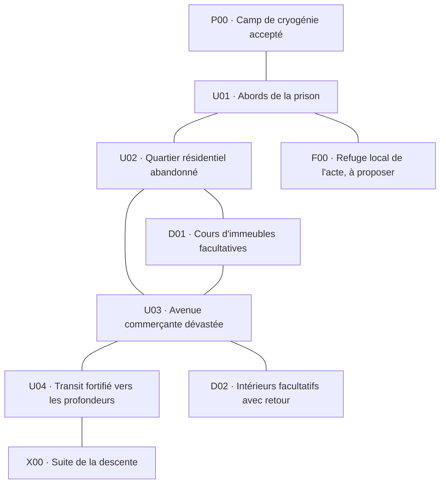

# ACT1-LAYOUT-01-r01 — premier chapitre urbain

18 octobre 2026. **Agencement accepté ; plans détaillés et décors à examiner.**

Le joueur répond « oui ca me va bien :) » à la présentation de ce schéma.
L'accord porte sur l'ordre des zones et les branches proposées, y compris
la place du refuge local près de l'arrivée. Les noms restent provisoires,
le découpage en cartes reste ouvert et aucun dessin, plan de rues, chiffre
de combat ou mécanisme de boss n'est validé par cet accord.
La trace et les empreintes présentées sont dans `act1-layout-acceptance-r01.json`.

## Direction retenue et portée de la revue

ACT1-CITY-01 retient une ville futuriste en pleine apocalypse, avec des lieux
détruits, abîmés et abandonnés. Le joueur confirme que cela correspond au récit.
Le camp de cryogénie déjà accepté demeure le départ. La mission conduit ensuite
vers les installations enfouies sous la mégapole, puis vers le plan démoniaque.

Cette revue propose uniquement l'ordre et le rôle des zones du premier chapitre.
Les intitulés ci-dessous sont des repères de travail, pas des noms de lieux
validés pour l'interface. Leur nombre ne fixe pas un nombre de cartes ou de quêtes.
Ni cette proposition ni son illustration ne sont des décors ou une carte jouable.

## Parcours proposé



**U01 — Abords de la prison.** Une rue d'accès et les restes d'un périmètre de
sécurité font la transition entre le camp existant et la ville. Le joueur peut
comprendre où poursuivre sans commencer par un vaste labyrinthe urbain.

**U02 — Quartier résidentiel.** Des immeubles abandonnés, des cours et des rues
partiellement détruites donnent une identité à la ville et varient les approches.
Une boucle par les cours rejoint l'avenue suivante. Elle reste facultative.

**U03 — Avenue commerçante.** Les vitrines, façades et commerces pillés ouvrent
des carrefours et contrastent avec les cours plus resserrées. Quelques intérieurs
accessibles, par exemple une boutique ou un garage, forment des détours courts.
Tous les bâtiments n'ont pas besoin d'un intérieur, mais chaque entrée présentée
comme praticable devra correspondre à un passage réel.

**U04 — Transit fortifié.** Un ancien accès de transport mène sous la ville.
Ce lieu marque la fin du parcours urbain et réserve une place au futur chef de
secteur. Son arène, son identité, ses patterns et la condition de passage ne
sont pas définis ici. Le détour résidentiel rejoint la route avant ce lieu.

**F00 — Refuge local de l'acte.** Un emplacement sûr est proposé près de
l'arrivée dans le chapitre, accessible sans traverser les quartiers suivants.
Cela conserve la distinction du récit entre le prologue de cryogénie et le
refuge local. Le plan de ce refuge, son habillage et ses habitants restent à
présenter ; il ne s'agit pas de refaire ou de déplacer le camp accepté.

## Ce que l'on prépare à la main et ce qui peut varier

Le raccord au camp, le refuge et le lieu de transition seront préparés puis
présentés séparément. Dans les quartiers de parcours, des blocs compatibles
peuvent varier : façades, rues, cours et intérieurs. Les raccords doivent garder
leurs accès praticables, leurs repères et un chemin principal accessible.

Les destructions doivent construire des lieux compréhensibles : un immeuble
éventré, une rue coupée, un commerce pillé. Les débris ne doivent pas recouvrir
uniformément toutes les cases ni transformer chaque rue en couloir étroit.
La largeur des rues, les surfaces et les distances seront testées avec la mêlée,
les tirs, la magie et les familiers avant de figer les plans.

Les futurs dessins garderont l'échelle du jeu et du personnage accepté. La
revue des décors montrera les modules et leurs raccords à taille native, puis
leur assemblage dans le moteur. Ce schéma ne promet pas une illustration
précomposée comme solution de collision ou de génération.

## Inspiration Diablo II et limites

L'[étude existante](../world-generation-study-01/ETUDE.md) conserve l'analyse
locale des tables et ses limites. Le [guide officiel des cartes de Blizzard](https://classic.battle.net/diablo2exp/maps/)
décrit des zones reliées et des passages secondaires, ainsi que des chemins
aidant à se repérer dans les premières régions. Nous retenons cette articulation
pour proposer nos quartiers, avec des lieux et des plans propres au projet.

Le chapitre reste dans une ville ; il n'est pas nécessaire de lui ajouter un
nouveau biome à chaque carte. L'alternance des rues, cours et intérieurs peut
varier les combats tout en conservant son identité urbaine.

La répartition des monstres sera étudiée après le terrain. La direction déjà
acceptée commence par les cultistes humains masqués ; aucun placement, quota,
pouvoir ou chiffre de difficulté supplémentaire n'est approuvé par ce schéma.
Les quêtes et les boss restent dans leurs étapes dédiées.

## Reproduction et vérifications

Source : `act1-city-layout-r01.json`. Reconstruction :

```text
python -X utf8 tools/reviews/build_act1_city_layout.py
```

L'aperçu reproductible est `artifacts/first-sector-review-01/act1-city-layout-r01.png`.
Les contrôles du graphe vérifient les raccords, le caractère facultatif des
détours, la boucle résidentielle et l'absence de contournement du transit final.
Ils ne vérifient ni une grille de déplacement, ni des collisions, ni un moteur
de génération. Aucun fichier de sauvegarde ou de l'éditeur n'est modifié.

L'agencement étant accepté, la prochaine revue détaille U01
avec un plan de rues, le raccord réel au camp et les premiers modules de décor.
