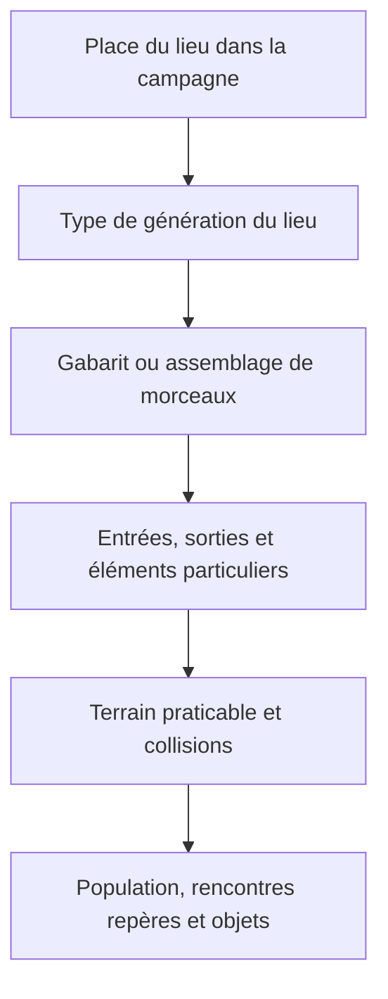

# Comment Diablo II construit son monde — PM01

17 octobre 2026 · **MONDE-PM01-01** · étude préparatoire, sans changement du jeu.

## Conclusion utile à notre projet

Diablo II combine une progression organisée, des lieux reconnaissables et des
parcours variables. Il ne choisit pas chaque case indépendamment. Cette méthode
convient à notre campagne : les camps, passages importants et arènes peuvent
rester lisibles, tandis que leurs environs changent d’une partie à l’autre.
Ce rapprochement est une recommandation de conception pour Project RL.

L’étude précédente traitait déjà les [familles et rencontres](../diablo2-study-2026-10-17/ETUDE.md).
Cette passe complète le terrain, les raccords et la place des éléments dessinés
à la main. Les propositions pour notre jeu figurent dans [PROPOSITION.md](PROPOSITION.md).

## Ce qui a réellement été vérifié

Les tables de l’installation `D:\JEUX\Diablo 2 old\Diablo II` et de son dossier
`ProjectD2` ont été lues dans les archives déjà utilisées pour l’étude précédente.
Leurs empreintes sont identiques. Les fonctions de lecture d’archive n’écrivent
pas dans l’installation. Aucune partie n’a été lancée, aucune sauvegarde consultée.

Pour chaque archive, les 131 entrées retenues couvrent les Id 1–132, hors niveau
bonus des vaches 39. Ce sont des entrées de tables, dont des villes et arènes,
pas 131 cartes entièrement aléatoires. Les paramètres structurels et points
de voyage sont comparés aux fichiers `LevelDefs.bin` et `Levels.bin` :
**4 192 valeurs vérifiées par archive**. Les 81 lignes de `LvlMaze` sont également
comparées à leur version compilée. [Chiffres et provenance](counts.json),
[contrôles reproductibles](validation.json).

Pour expliquer le moteur, la référence est **D2MOO, une réimplémentation issue
de rétro-ingénierie de LoD 1.10f**, épinglée à la révision
`0c0bbd1e6bef9181a3da1c046523af622a925416`. Ce n’est ni le code source officiel
de Blizzard, ni celui du moteur fermé de PD2. Ses auteurs décrivent eux-mêmes
ce périmètre dans le [README](https://github.com/ThePhrozenKeep/D2MOO/blob/0c0bbd1e6bef9181a3da1c046523af622a925416/README.md).
Les sources primaires de Blizzard complètent ce relevé pour le fonctionnement
des cartes et du voyage. Aucun algorithme ou dessin de Diablo n’est intégré au projet.

## 1. Le monde et le plan local sont deux problèmes différents

Le guide officiel décrit une succession de zones avec des passages et,
selon les lieux, des accès secondaires en surface ou en sous-sol. Les routes
de l’acte I aident à s’orienter ; les actes suivants demandent davantage
d’exploration. [Arreat Summit — Maps](https://classic.battle.net/diablo2exp/maps/).

Il faut donc distinguer **la place d’un lieu dans l’aventure** et **le trajet
exact pour le traverser**. On peut savoir qu’un secteur mène à un verrou ou à
un chef sans connaître à l’avance ses couloirs, embranchements ou accès annexes.
Les liaisons déclarées `Vis#` et `Warp#` aident à décrire les raccords ; elles
ne suffisent pas à reconstruire toutes les relations gérées par le code et
les quêtes. La référence D2MOO prévoit notamment une variation de raccordement
dans la jungle. Le graphe complet n’est donc pas présenté ici comme immuable.
[DrlgDrlg, allocation et initialisation](https://github.com/ThePhrozenKeep/D2MOO/blob/0c0bbd1e6bef9181a3da1c046523af622a925416/source/D2Common/src/Drlg/DrlgDrlg.cpp).



Ce schéma sépare les responsabilités ; ce n’est pas une transcription ligne
par ligne de toutes les routines de Diablo II.

## 2. Trois générateurs qui peuvent tous employer des morceaux préparés

La fonction `DRLG_InitLevel` initialise la graine du niveau et sélectionne
`MAZE`, `PRESET` ou `OUTDOOR`. Leurs valeurs sont déclarées dans les en-têtes.
[Sélection du générateur](https://github.com/ThePhrozenKeep/D2MOO/blob/0c0bbd1e6bef9181a3da1c046523af622a925416/source/D2Common/src/Drlg/DrlgDrlg.cpp),
[types](https://github.com/ThePhrozenKeep/D2MOO/blob/0c0bbd1e6bef9181a3da1c046523af622a925416/source/D2Common/include/Drlg/D2DrlgDrlg.h).

| Méthode technique | Entrées LoD | Entrées PD2 | Exemples locaux | Lecture utile |
| --- | ---: | ---: | --- | --- |
| `MAZE` | 68 | 68 | Antre du Mal, caserne, catacombes 2, tombeaux | Assembler des salles et raccords selon la famille du lieu |
| `PRESET` | 34 | 34 | Villes, catacombes 4, salle de Mephisto, trône | Charger un plan préparé, éventuellement choisi parmi plusieurs fichiers |
| `OUTDOOR` | 29 | 29 | Landes sanglantes, Canyon des Mages, Travincal, Sanctuaire du Chaos | Construire une surface avec limites, passages et morceaux particuliers |

Les catégories sont des modes techniques. `OUTDOOR` ne signifie pas que tout
le lieu est aléatoire ou qu’il doit visuellement ressembler à une prairie.
Travincal et la fin du Sanctuaire du Chaos sont des exemples de plans
reconnaissables cités par Blizzard alors que leurs entrées utilisent ce mode.
[Arreat Summit — Dungeon Randomization](https://classic.battle.net/diablo2exp/basics/index.shtml).

### Labyrinthes : une bibliothèque de salles avec des raccords

`DrlgMaze` possède des traitements propres aux familles de donjons et des
variantes de morceaux pour les sorties, points de voyage et salles particulières.
Il fait croître et relie des salles, puis sélectionne des éléments compatibles.
Ce n’est pas simplement une suite de rectangles sans identité.
[DrlgMaze](https://github.com/ThePhrozenKeep/D2MOO/blob/0c0bbd1e6bef9181a3da1c046523af622a925416/source/D2Common/src/Drlg/DrlgMaze.cpp).

Dans les tables locales, les catacombes 2 déclarent `Rooms=14` et un gabarit
de salle de 12×12 ; le tombeau Id 67 déclare 6 et 16×16. Ce sont des paramètres
de départ dans les unités du moteur. Les traitements particuliers peuvent
ajouter ou transformer des salles : ces nombres ne mesurent ni des salles
effectivement parcourues dans une partie, ni des cases de 64 px de Project RL.

### Prédéfinis : dessinés à la main ne veut pas toujours dire uniques

Le chargement d’un `PRESET` peut tirer un fichier parmi ceux de sa définition
`LvlPrest`. Le contour principal peut être très stable, avec plusieurs variantes
préparées. Les données de morceaux portent aussi des unités prédéfinies et
des couches de terrain. Le dessin manuel et l’aléatoire se combinent donc à
plusieurs échelles. [DrlgPreset](https://github.com/ThePhrozenKeep/D2MOO/blob/0c0bbd1e6bef9181a3da1c046523af622a925416/source/D2Common/src/Drlg/DrlgPreset.cpp).

Le guide officiel donne lui-même la Tour oubliée V comme exemple de plan
stable avec deux versions. On peut garder un repère reconnaissable sans
imposer exactement le même fichier partout. [Randomisation des donjons](https://classic.battle.net/diablo2exp/basics/index.shtml).

### Surfaces : organiser les limites et les repères

La référence `DrlgOutdoors` construit des zones avec des grilles et des
traitements propres aux actes ; elle peut y poser des morceaux prédéfinis.
L’aléatoire travaille à l’intérieur d’une organisation du lieu, avec des
transitions et points particuliers. Il n’y a pas un seul algorithme universel
appliqué indifféremment à chaque paysage.
[DrlgOutdoors](https://github.com/ThePhrozenKeep/D2MOO/blob/0c0bbd1e6bef9181a3da1c046523af622a925416/source/D2Common/src/Drlg/DrlgOutdoors.cpp).

Pour notre univers, cette méthode inspire les halls industriels, cours
fortifiées et grandes cavités, avec bâtiments, plateformes et accès préparés.
Ce sont des idées propres à Project RL, pas des lieux déjà validés.

## 3. Les tables se partagent le travail

| Donnée | Ce qu’elle apporte à l’étude | Ce qu’il serait faux d’en déduire |
| --- | --- | --- |
| `Levels` / `LevelDefs` | Méthode, dimensions par difficulté, références de raccords et points de voyage | Une carte jouée complète ou tous les liens de quête |
| `LvlMaze` | Paramètres de salles et de construction | Le nombre exact de pièces finales dans toute situation |
| `LvlPrest` | Définitions et fichiers de plans préparés | Un niveau jouable différent pour chaque ligne |
| `LvlTypes` | Bibliothèques de terrain graphique | Un acte ou une campagne par ligne |
| `LvlSub` | Substitutions et paramètres de motifs | L’intégralité de la décoration et de la logique des objectifs |

Les offsets compilés sont vérifiés à partir des déclarations et du compilateur
de données de la référence épinglée :
[LevelsTbls.h](https://github.com/ThePhrozenKeep/D2MOO/blob/0c0bbd1e6bef9181a3da1c046523af622a925416/source/D2Common/include/DataTbls/LevelsTbls.h),
[LevelsTbls.cpp](https://github.com/ThePhrozenKeep/D2MOO/blob/0c0bbd1e6bef9181a3da1c046523af622a925416/source/D2Common/src/DataTbls/LevelsTbls.cpp).

## 4. Graine, exploration et retours

La référence initialise une graine de génération puis des graines de niveau ;
les choix de morceaux utilisent ces états. Retrouver un plan demande les mêmes
paramètres et données de génération, pas seulement un numéro isolé de graine.
[DrlgDrlg](https://github.com/ThePhrozenKeep/D2MOO/blob/0c0bbd1e6bef9181a3da1c046523af622a925416/source/D2Common/src/Drlg/DrlgDrlg.cpp).

Le voyage est un autre système. Le guide officiel distingue les points de
voyage activés et conservés avec le personnage des portails de retour local.
Il décrit le passage entre points déjà activés, y compris entre actes.
[Arreat Summit — Waypoints et Town Portal](https://classic.battle.net/diablo2exp/basics/index.shtml).

Pour Project RL, le voyage rapide entre camps débloqués est déjà retenu.
La conservation de la géométrie, le renouvellement des ennemis, les récompenses
uniques et le retour local doivent être spécifiés séparément. Recharger la
partie ne doit pas devenir implicitement une commande de renouvellement du monde.
Ce dernier point est une recommandation à valider avant intégration.

## 5. Ce que PD2 change dans les données examinées

Les 32 champs structurels comparés ne diffèrent pas pour les 131 entrées de
campagne. Leurs méthodes et les 39 références de points de voyage sont donc
identiques dans ces tables locales. PD2 contient ici 1 157 définitions numériques
`LvlPrest`, contre 1 091 dans LoD, et 46 lignes numériques `LvlTypes`, contre 36.

Ces écarts ne comptent pas directement des cartes supplémentaires. Ils ne
prouvent pas non plus que la campagne jouée a exactement les mêmes plans :
des fichiers de morceaux, scripts ou routines peuvent avoir changé. Aucune
saison précise ni fidélité du moteur PD2 à la référence 1.10f n’est déduite.

## 6. Ce qui existe déjà dans Project RL

Le code actuel possède déjà des générateurs déterministes, des passages
régionaux concordants et une validation des accès. Il n’est pas nécessaire
de recommencer ces fondations.

- [`rooms.rs`](../../../../src/world/generation/rooms.rs) place des salles et
  relie chaque nouvelle salle à la précédente. C’est un générateur existant,
  pas encore une bibliothèque de modules narratifs du premier secteur.
- [`regional.rs`](../../../../src/world/generation/regional.rs) produit le
  terrain depuis une graine et garantit des passages cardinaux ; ces passages
  ne suffisent pas à définir le graphe d’actes de la nouvelle histoire.
- [`validation.rs`](../../../../src/world/generation/validation.rs) contrôle
  les chemins, positions requises et commandes ouvrant des portes. Cette base
  est utile pour éviter une progression bloquée après ajout des décors.
- [`regional_landmark.rs`](../../../../src/world/generation/regional_landmark.rs)
  sépare déjà certains tirages de sites et repères par leurs graines.

Le cahier de campagne doit surtout préciser **ce qui doit être présent, ce qui
peut varier et comment les cartes se raccordent**. Les images du bestiaire ne
fixent pas l’occupation physique des grandes créatures ; celle-ci devra rester
distincte de la place nécessaire pour les dessiner lisiblement.

## 7. Adaptation au tour par tour

Un détour est une succession d’actions dans notre jeu. Copier de grandes
distances ou la densité du temps réel risquerait de produire surtout de la
marche et des engagements trop nombreux à la fois. Les couloirs doivent aussi
laisser fonctionner mêlée, tir, magie et familiers.

Je recommande donc un premier secteur court à tester, des embranchements qui
offrent un choix réel, quelques boucles ou raccourcis, et des zones de combat
dont les lignes de vue et possibilités de repli peuvent être vérifiées.
Les dimensions, densités et distances ne sont pas chiffrées ici : elles seront
mesurées avec les compétences et le peuplement représentatifs de PM04/PM05.
Le bonus de monstre « Rapide » reste exclu.

## Reproduction et limites

```text
C:\Windows\SysWOW64\WindowsPowerShell\v1.0\powershell.exe -NoProfile -File tools/art/extract_diablo2_tables_readonly.ps1
python tools/art/study_diablo2_world.py
python tools/art/study_diablo2_world.py --check
```

Les tables complètes et copies de code restent dans le dossier d’étude ignoré
sous `artifacts/`. Les résultats dérivés et la provenance restent dans cette
revue. Aucune ressource Diablo n’est utilisée à la compilation du jeu.

PM01 fournit ici une base vérifiable pour choisir notre structure. L’observation
d’une carte réellement jouée pourrait encore préciser le rythme ressenti ;
elle n’est pas présentée comme réalisée. PM00 conserve ses problèmes techniques
ouverts, dont les échecs d’application répertoriés dans la revue du bestiaire.
Les défauts critiques de reprise devront être résolus avant d’activer un nouveau
générateur, conformément au plan de travail.
