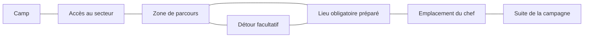

# Base proposée pour notre monde — préparation de PM02

17 octobre 2026 · base **MONDE-01 à MONDE-04 validée**, non intégrée au jeu.

Le joueur répond « oui ca me convient parfaitement » à la présentation de cette
base. L’[accord de conception](design-acceptance-01.json) conserve le périmètre.
Il demande ensuite de créer les décors au fil du développement des cartes.

L’[étude PM01](ETUDE.md) explique la référence. Ce document propose notre propre
structure ; il ne reprend ni plans, ni décors, ni code de Diablo II.
Les schémas décrivent des fonctions, pas des noms définitifs destinés au joueur.

## MONDE-01 — Une génération hybride

Je propose de combiner :

- Des **camps au plan stable**, compacts, dont les services se retrouvent facilement.
- Des **zones de parcours assemblées**, avec plusieurs variantes de salles,
  couloirs, halls, cours ou cavités adaptées au secteur.
- Des **lieux importants préparés à la main**, comme un verrou de progression,
  une scène narrative ou une future arène, raccordés au parcours généré.

Les modules doivent indiquer leurs accès, leurs éléments bloquants et les
emplacements qu’ils réservent. Leur diversité sert à varier les approches et
les combats, au-delà d’une simple inversion des pièces.

Le premier prototype utilisera un petit ensemble de modules et de décors
provisoires. Les décors définitifs et les boss restent dans leurs étapes dédiées.

## MONDE-02 — Un plan conservé pendant la partie

Je propose qu’une carte découverte garde sa géométrie dans la même partie,
y compris après retour au camp, voyage et sauvegarde. Une nouvelle campagne
peut tirer de nouveaux parcours.

Cette proposition ne fixe **pas** le renouvellement des ennemis, boss, coffres
ou butins. Ces règles restent à concevoir séparément pour les revisites et
la recherche d’XP. Les faits de quête et récompenses uniques devront conserver
leur état ; recharger ne doit pas remettre un objectif accompli à zéro.

La génération devra conserver sa graine **et sa version de données**, avec
la reprise compatible appropriée. Une nouvelle règle ne transforme pas
silencieusement les cartes d’une ancienne sauvegarde.

## MONDE-03 — Un trajet principal avec des détours et quelques boucles

Je propose de commencer par le secteur des accès fortifiés du manuscrit,
sans en figer encore le nombre de cartes. Le trajet principal conduit au
verrou du secteur puis à l’emplacement réservé au chef. Les détours donnent
des espaces facultatifs et peuvent rejoindre un passage déjà découvert.

Ce schéma illustre les rôles et une boucle possible. Chaque boîte n’impose
ni une carte distincte, ni un quota de quêtes ; le détour n’ouvre pas un accès
qui permettrait d’ignorer un objectif obligatoire. Les raccords exacts et
conditions seront spécifiés avant le prototype.

Le voyage rapide entre camps déjà débloqués reste le principe accepté.
Les retours locaux ne sont pas confondus avec ce réseau, ni avec les excursions
par portails bonus. Aucune commande, durée ou dépense nouvelle n’est fixée ici.

## MONDE-04 — Valider la circulation avant la décoration définitive

Je propose de vérifier le premier parcours sur plusieurs graines avant de
produire les décors définitifs :

- L’entrée, les objectifs et la sortie sont accessibles dans l’ordre voulu.
- Le contrôle ou objet nécessaire est accessible avant le passage qu’il ouvre.
- Les morceaux raccordés ne laissent ni trou de terrain ni passage condamné.
- Les points d’apparition et les décors ne bloquent pas les accès indispensables.
- Le parcours offre des lignes de tir, approches et replis utilisables avec
  mêlée, distance, magie et familiers.
- Les grandes silhouettes restent lisibles ; leurs tailles graphiques
  ne deviennent pas automatiquement de nouvelles règles de collision.

Les distances, largeurs et densités resteront des paramètres à tester. Le
premier secteur jouable permettra de les mesurer avant l’extension aux autres.

## Décision enregistrée

La base hybride, la conservation des plans dans une partie et la méthode du
premier secteur sont acceptées. Cet accord ne fixe pas un nombre de cartes,
un nouveau voyage, une quête, un décor final ou des chiffres de combat.

PM02 détaille les familles de cartes, leurs entrées/sorties,
les objectifs à réserver et le contrat de raccordement dans le
[cahier de génération](../../../GENERATION_CAMPAGNE.md). La mise en jeu du
générateur restera PM03, après les vérifications de stabilité nécessaires.
